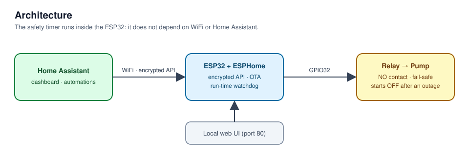
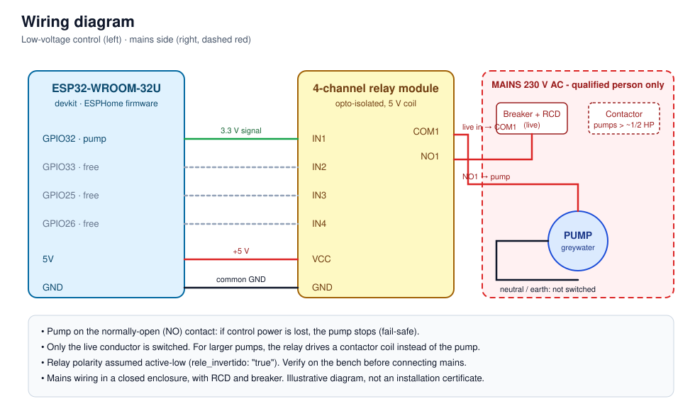

# Controlador de bomba de aguas grises

[English](README.md) · [Español](README.es.md)

[](https://github.com/bergamifer/greywater-pump-controller/actions/workflows/ci.yml)


Control remoto y a prueba de fallos de la **bomba de aguas grises** de una vivienda desde
[Home Assistant](https://www.home-assistant.io/), con hardware barato (un ESP32 y un módulo de relés) y firmware
declarativo en [ESPHome](https://esphome.io/). Sin nube y sin app propia.



## Características

- **Encendido y apagado desde Home Assistant**, con descubrimiento automático por mDNS y API cifrada.
- **Apagado de seguridad por tiempo**: la bomba se apaga sola al cumplirse un tiempo máximo de marcha configurable
  (30 min por defecto, ajustable desde Home Assistant). El temporizador corre dentro del ESP32: si se cae el WiFi
  o Home Assistant, la bomba no queda funcionando en seco.
- **Fail-safe por diseño**: la carga va al contacto normalmente abierto y, tras un corte de luz, la bomba arranca
  **apagada** (`restore_mode: ALWAYS_OFF`). Nada se enciende solo.
- **Interfaz web local** en el propio equipo, para operar sin Home Assistant.
- **Estado legible**: sensor de texto `ENCENDIDA - bombeando` / `APAGADA - no bombea`.
- **Actualización OTA cifrada** y punto de acceso de rescate si falla el WiFi.
- Diagnóstico: señal WiFi, dirección IP, botón de reinicio.
- Tres canales de relé libres para ampliar (válvulas, sensores de nivel, etc.).

## Estado del proyecto

Prototipo de banco. El firmware se compila en CI en cada push. El temporizador de seguridad y el cableado de la
bomba **todavía no se probaron en la instalación final**: verificá la polaridad del relé y el timeout en el banco
antes de conectar una bomba.

## Hardware

| Pieza | Notas |
|---|---|
| Devkit ESP32-WROOM-32U | antena externa (U.FL) |
| Módulo de 4 relés | optoacoplado, bobina de 5 V, 10 A / 250 V nominal |
| Bomba | en el canal 1 del relé, contacto normalmente abierto |

### Asignación de pines

| Función | GPIO | Notas |
|---|---|---|
| Bomba (relé 1) | 32 | no es pin de arranque (*strapping*), no emite pulsos al bootear |
| Canales libres 2 / 3 / 4 | 33 / 25 / 26 | ídem |
| LED de estado | 2 | parpadea ante problemas de WiFi/API |
| Entradas analógicas libres | 34, 35, 36, 39 | ADC1 (ADC2 no funciona con WiFi activo) |

### Conexionado



> **Seguridad eléctrica.** El relé declara 10 A, pero una bomba consume varias veces su corriente nominal al
> arrancar y las borneras del módulo son limitadas. Para bombas de más de ~1/2 HP, el relé debe comandar un
> **contactor**, no la bomba. El cableado de 220 V debe hacerlo una persona competente, con disyuntor diferencial
> y térmica, en gabinete cerrado.

## Puesta en marcha

Requisitos: Python 3 y [ESPHome](https://esphome.io/guides/installing_esphome).

```bash
git clone https://github.com/bergamifer/greywater-pump-controller.git
cd greywater-pump-controller/esphome

cp secrets.example.yaml secrets.yaml     # completar WiFi y claves
openssl rand -base64 32                  # usar el resultado como api_key

esphome run bomba.yaml --device /dev/ttyUSB0   # primera carga por USB
esphome run bomba.yaml                         # luego, OTA por WiFi
esphome logs bomba.yaml                        # logs por red
```

En Home Assistant el equipo aparece como **"Bomba aguas grises"** y pide la clave de API. Si Home Assistant pide
permiso para manejar dispositivos ESPHome, hay que aceptarlo: si no, las entidades quedan *Unavailable*. Hay una
tarjeta de ejemplo en [`docs/home-assistant/dashboard.yaml`](docs/home-assistant/dashboard.yaml).

### Polaridad del relé

`rele_invertido: "true"` (activo-bajo) es lo habitual en módulos de 4 canales con optoacoplador. Si el relé
conmuta al revés, cambiar esa constante en `esphome/bomba.yaml`.

### Apagado de seguridad

Ajustá **"Tiempo máximo de marcha"** (1-120 min) desde Home Assistant o la página web del equipo. Al encender la
bomba arranca el temporizador; al apagarla, o al vencer el tiempo, se detiene. El valor sobrevive a reinicios.

## Estructura del repositorio

```
├── esphome/
│   ├── bomba.yaml              # firmware
│   └── secrets.example.yaml    # plantilla de credenciales (secrets.yaml no se versiona)
├── docs/
│   ├── architecture.svg
│   ├── wiring.svg
│   └── home-assistant/dashboard.yaml
├── .github/workflows/ci.yml    # valida y compila el firmware
├── CONTRIBUTING.md
└── LICENSE
```

## Roadmap

- [x] Apagado de seguridad por tiempo
- [x] CI: validar y compilar el firmware
- [ ] Sensor de nivel/humedad para operación automática
- [ ] Probar en banco el temporizador y la polaridad del relé; fotos de la instalación
- [ ] Reserva de IP en el router y dashboard dedicado en Home Assistant

## Licencia

[MIT](LICENSE)
