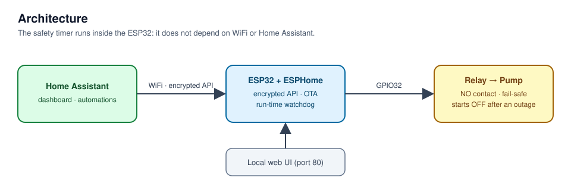
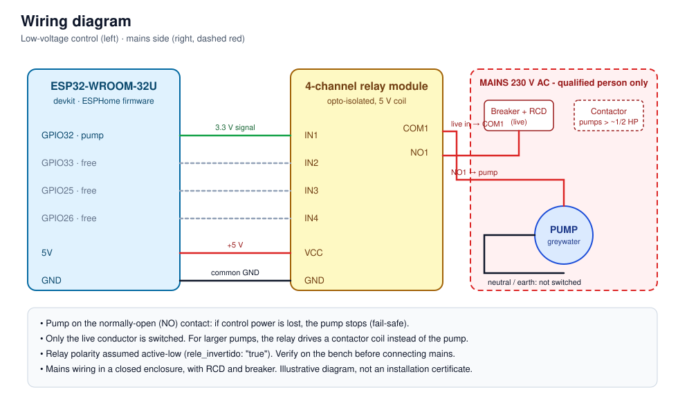

# Greywater Pump Controller

[English](README.md) · [Español](README.es.md)

[](https://github.com/bergamifer/greywater-pump-controller/actions/workflows/ci.yml)


Remote, fail-safe control of a household **greywater pump** from [Home Assistant](https://www.home-assistant.io/),
with low-cost hardware (an ESP32 and a relay module) and declarative [ESPHome](https://esphome.io/) firmware.
No cloud, no custom app.



## Features

- **On/off from Home Assistant**, with automatic mDNS discovery and an encrypted API.
- **Run-time safety timer**: the pump switches itself off after a configurable maximum run time
  (default 30 min, adjustable from Home Assistant). The timer runs inside the ESP32, so a lost WiFi link or a
  crashed Home Assistant cannot leave the pump running dry.
- **Fail-safe by design**: the load is wired to the normally-open contact, and after a power cut the pump
  starts **off** (`restore_mode: ALWAYS_OFF`). Nothing turns on by itself.
- **Local web interface** on the device, to operate it without Home Assistant.
- **Readable status** sensor: `ENCENDIDA - bombeando` / `APAGADA - no bombea`.
- **Encrypted OTA updates** and a rescue access point if WiFi fails.
- Diagnostics: WiFi signal, IP address, restart button.
- Three spare relay channels for future expansion (valves, level sensors, ...).

## Project status

Bench prototype. The firmware compiles in CI on every push. The safety timer and the pump wiring have **not yet
been tested on the final installation**: verify relay polarity and the timeout on the bench before connecting
a pump.

## Hardware

| Part | Notes |
|---|---|
| ESP32-WROOM-32U devkit | external antenna (U.FL) |
| 4-channel relay module | opto-isolated, 5 V coil, 10 A / 250 V nominal |
| Pump | on relay channel 1, normally-open contact |

### Pin map

| Function | GPIO | Notes |
|---|---|---|
| Pump (relay 1) | 32 | not a strapping pin, emits no pulse at boot |
| Spare channels 2 / 3 / 4 | 33 / 25 / 26 | same |
| Status LED | 2 | blinks on WiFi/API trouble |
| Free analog inputs | 34, 35, 36, 39 | ADC1 (ADC2 does not work while WiFi is on) |

### Wiring



> **Electrical safety.** The relay is rated 10 A, but a pump draws several times its nominal current at start-up
> and the module's terminals are limited. For pumps above ~1/2 HP the relay must drive a **contactor**, not the
> pump. Mains wiring must be done by a competent person, with an RCD and breaker, in a closed enclosure.

## Getting started

Requirements: Python 3 and [ESPHome](https://esphome.io/guides/installing_esphome).

```bash
git clone https://github.com/bergamifer/greywater-pump-controller.git
cd greywater-pump-controller/esphome

cp secrets.example.yaml secrets.yaml     # fill in WiFi and keys
openssl rand -base64 32                  # use the output as api_key

esphome run bomba.yaml --device /dev/ttyUSB0   # first flash over USB
esphome run bomba.yaml                         # later, OTA over WiFi
esphome logs bomba.yaml                        # logs over the network
```

In Home Assistant the device shows up as **"Bomba aguas grises"** and asks for the API key. If Home Assistant
asks for permission to manage ESPHome devices, accept it, or the entities stay *Unavailable*. An example
dashboard card is in [`docs/home-assistant/dashboard.yaml`](docs/home-assistant/dashboard.yaml).

### Relay polarity

`rele_invertido: "true"` (active-low) is typical for opto-isolated 4-channel modules. If the relay switches the
wrong way, change that constant in `esphome/bomba.yaml`.

### Safety timeout

Set **"Tiempo máximo de marcha"** (1-120 min) from Home Assistant or the device web page. Turning the pump on
starts the timer; turning it off, or the timer expiring, stops it. The value survives reboots.

## Repository layout

```
├── esphome/
│   ├── bomba.yaml              # firmware
│   └── secrets.example.yaml    # credentials template (secrets.yaml is git-ignored)
├── docs/
│   ├── architecture.svg
│   ├── wiring.svg
│   └── home-assistant/dashboard.yaml
├── .github/workflows/ci.yml    # validates and compiles the firmware
├── CONTRIBUTING.md
└── LICENSE
```

## Roadmap

- [x] Run-time safety timer
- [x] CI: validate and compile the firmware
- [ ] Level / moisture sensor for automatic operation
- [ ] Bench-test the timer and the relay polarity, photos of the installation
- [ ] DHCP reservation and a dedicated Home Assistant dashboard

## License

[MIT](LICENSE)
